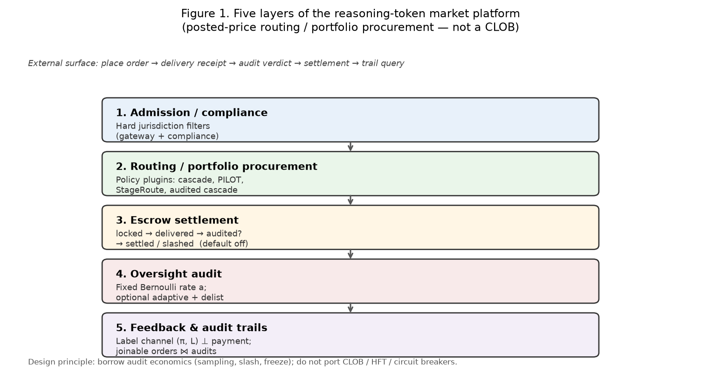
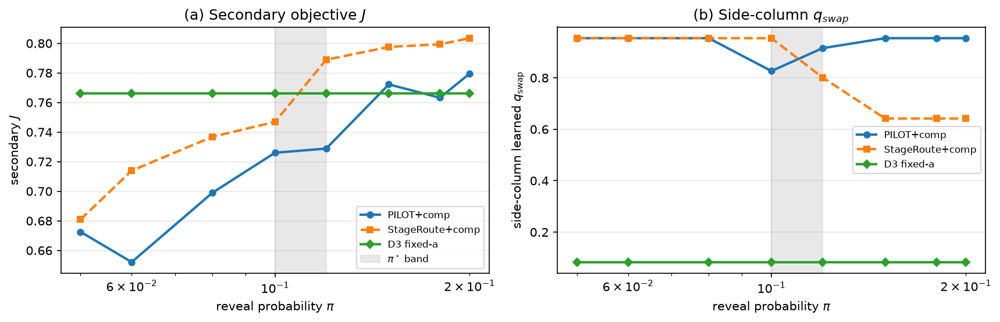

# A Compliance-Constrained Reasoning-Token Market Simulator and Benchmark for Procurement under Sparse Audit Feedback

**Working draft (v0.1, camera-ready polish)** — Datasets & Benchmarks track (NeurIPS / ICLR or equivalent).  
**Companion paper.** Deterrence-method novelty (platform audits as a strategic signal that compresses seller attack rates) is owned by a separate methods paper; this draft contributes the **platform, publishable data schema, fixed evaluation protocol, and baselines**.

---

## Abstract

Cross-border procurement of LLM inference increasingly looks like a marketplace: buyers route tasks under jurisdiction constraints, sellers post prices and capacities, and quality—and fraud—are revealed only partially and late. Existing simulators either study exchange microstructure (limit-order books, high-frequency trading) or bandit-style routing under *immediate* correctness labels. Neither couples **hard compliance filters**, **strategic seller fraud** (model swap and token theft), **escrow / slash settlement**, and **sparse or delayed outcome labels** in one reproducible generator.

We release a **compliance-constrained reasoning-token market simulator**—not a CLOB—together with a five-file JSONL schema, one-click export scripts, and a fixed benchmark protocol. The platform has five layers: admission/compliance, routing and portfolio procurement, escrow settlement, oversight audit, and feedback/audit trails. Primary leaderboard metrics are **active trade attack rate** (`active_attack_rate`) and **realized fraud share** (`fraud_share`); epoch-mean learned \(q^\star\) (`learned_q_swap` / `learned_q_theft`) are **side columns** (especially informative when delist is on; see §5), not co-primary. The joint objective \(J\) is secondary, and immediate-feedback \(J\) against PILOT / StageRoute is **not** the primary ranking. Protocol tasks cover fixed-rate audit deterrence (T1), sparse-label regime switches (T2), and equal-budget adaptive audit as an appendix efficiency check (T3). On a dense reveal-probability grid we document a regime crossover \(\pi^\star \in (0.10, 0.12)\) where sparse labels collapse bandit avoidance while fixed-rate audits keep \(q^\star\) stable near \(0.08\). We release seeds, config hashes, the frozen pack under `release/v0.1/` (mirroring `exports/production/`), and Feature/Label hygiene rules so the downloadable board supports leaderboard submission without silently leaking supervision for fraud detectors. Deterrence *methods* are out of scope here (companion paper).

---

## 1. Introduction

Deployed LLM APIs are increasingly bought and sold across jurisdictions. A buyer in one country may be barred from shipping personal data to another; a seller may advertise a strong model and serve a weaker one (swap), or bill for more tokens than were generated (theft); correctness labels for purchased answers arrive sparsely and often with delay. Procurement therefore mixes **compliance**, **strategic incentives**, and **incomplete feedback**—yet public benchmarks for this setting are scarce.

Two nearby literatures miss the coupling. Market-microstructure and exchange simulators emphasize continuous limit-order books, latency races, and circuit breakers—machinery that is orthogonal to posted-price reasoning services. Bandit and portfolio routers such as PILOT and StageRoute assume (or are evaluated under) rich, often immediate, outcome feedback and typically ignore strategic sellers and escrowed payments. Cloud-API SLA dispute stories and advertising-quality audits share the *economic* idea of sampling and penalties, but do not ship a joinable, seed-locked generator for multi-jurisdiction reasoning procurement.

**This paper** treats the research artifact as a **platform that generates benchmarks**. We ask: can one simulator expose a stable evaluation surface for (i) deterrence under fixed audit budgets, (ii) sparse/delayed labels, and (iii) audit-cost efficiency—without claiming a new “best router under full feedback”?

**Contributions.**

1. **Five-layer trading platform** for compliance-constrained reasoning-service trades: admission → routing/portfolio procurement → escrow settlement → oversight → feedback and trails. Design principle: borrow *audit economics* (sampling, slash, freeze); do **not** port CLOB, HFT, circuit breakers, or multi-CCP clearing.
2. **Publishable five-file JSONL schema** (`sellers`, `buyers`, `orders`, `audits`, `episodes`) with join keys, config hashes, and one-click scripts; optional held-out `labels.jsonl`.
3. **Tasks T1–T3** with frozen seeds; primary board = `active_attack_rate` + `fraud_share` only (`learned_q_*` side columns; \(J\) secondary—**not** “beat PILOT on \(J\)”); protocol result \(\pi^\star \in (0.10, 0.12)\) as a sparse-label *regime switch* (bandit collapse), not a claim that audited routing dominates bandits under full feedback.
4. **Baselines**: PILOT+compliance, StageRoute+compliance, fixed-\(a\) audited cascade (D3), random audit; adaptive audit and post-catch delist as **appendix** switches (defaults off so legacy tables remain reproducible).

**Claim ownership.** Deterrence theory and method novelty live in a companion methods paper. Here the contribution is the generator, the protocol, and the leaderboard contract.

---

## 2. Related Work

We situate the artifact against five nearby literatures and a companion methods paper. The gap we target is the *coupling* of hard compliance filters, strategic seller fraud, sparse/delayed correctness labels, and escrow/audit settlement in one seed-locked generator—not incremental gains on any single line of work under dense feedback.

**Cloud / API marketplaces and SLA disputes.** Commercial LLM/API marketplaces and cloud SLAs document uptime credits, refunds, and support-case dispute flows (e.g., provider compute SLAs and marketplace terms [@aws2024compute_sla]), but they do not release multi-agent, seed-locked synthetic trade logs with jurisdiction hard filters and controllable strategic fraud knobs. Our contribution is a research generator and leaderboard contract, not a commercial marketplace replica.

**Audit economics, inspection games, and advertising-quality sampling.** Classical enforcement and audit theory treat random inspection plus penalties as a deterrent when full verification is costly [@becker1968crime; @avenhaus2002inspection]. Advertising and product-quality settings similarly motivate sampling audits, reputation holds, and disclosure costs rather than exhaustive checks [@daughety2008communicating; @bester2021signaling]. We borrow *sampling rate*, *slash/penalty*, and optional *freeze/delist*; we do **not** model ad auctions, click fraud scoring, or truth-in-advertising litigation.

**Prediction-market dispute resolution and delayed labels.** Prediction markets separate trading from outcome resolution: optimistic oracles and dispute bonds (e.g., UMA-style resolution used by Polymarket) delay settlement until a challenge window closes or a vote completes [@wolfers2004prediction; @hanson2003combinatorial; @uma2024optimistic; @polymarket2024resolution]. That is a useful *label-timing* analogy. In our platform the label channel \((\pi, L)\) is orthogonal to payment escrow: billed cost is observed immediately on the buyer side, while correctness may be delayed or dropped; audits update trust/slash on their own clock.

**Bandit / portfolio LLM routing under immediate feedback.** PILOT [@panda2025pilot] casts budgeted LLM routing as a preference-prior contextual bandit (LinUCB + online multi-choice knapsack). StageRoute [@li2026stageroute] couples stage-wise deployment with per-query budget/throughput LPs and near-optimal \(\tilde{\mathcal{O}}(T^{2/3})\) regret. Our `pilot_*` / `stageroute_*` baselines are **simplified reimplementations** (hand-crafted task features; StageRoute’s stage MIP skipped with a fixed seller set)—strong under dense correctness labels. Under sparse \(\pi\) they *avoid* the fraudulent seller rather than compress attack intensity \(q^\star\); we therefore treat their immediate-feedback \(J\) as **secondary**, not as the primary board.

**Exchange surveillance vs. order-book microstructure.** Market-surveillance practice and guidance emphasize monitoring, investigation, and temporary freezes on suspicious activity [@iosco2009surveillance; @cumming2008surveillance]. Escrow, stake slash, and post-catch listing pauses in our oversight layer are inspired by that *enforcement* toolkit. Continuous limit-order books, maker–taker fees, HFT latency races, and circuit breakers are explicitly **out of scope**—the market is posted-price routing / portfolio procurement, not a CLOB.

**Positioning vs. the companion methods paper.** That paper owns deterrence *method* claims (fixed-\(a\) audits as a strategic signal that compresses seller \(q^\star\)). This paper owns the platform-as-benchmark-generator, five-file schema, Feature/Label hygiene, and the T1–T3 leaderboard contract. Cross-cite, do not absorb, the method novelty.

---

## 3. Platform Design

The artifact is a **posted-price reasoning-service market** with jurisdiction-aware buyers and sellers. Buyers spend budget on tasks with gold answers; sellers advertise models, prices, and capacity. Matching is **routing / portfolio procurement**, not a limit-order book.

### 3.1 Five layers (Figure 1)

| Layer | Role | Code map |
|---|---|---|
| 1. Admission / compliance | Hard jurisdiction filters; blocked flows never become served purchases | `gateway.py`, `compliance.py` |
| 2. Routing / portfolio procurement | Policy plugins (cascade, PILOT, StageRoute, audited cascade, …) | `matching.py`, `portfolio.py`, `buyers.py`, `baselines.py` |
| 3. Escrow settlement | State machine `locked → delivered → audited? → settled/slashed` (default **off**) | `sim.py`, `audit_v6.py` |
| 4. Oversight | Fixed Bernoulli audit rate \(a\) (main path); optional adaptive boost & delist | `strategic.py`, `audit_v6.py` |
| 5. Feedback & trails | Label channel \((\pi, L)\) orthogonal to payment; structured audit fields | `feedback.py`, `logging_schema.py` |

**External surface.** Place order; delivery receipt; audit verdict; settlement; trail query (via joinable `orders`/`audits` exports).



**Figure 1.** Five platform layers (admission → routing/portfolio procurement → escrow → oversight → feedback/trails). Posted-price market; not a CLOB. Source art: `docs/figures/fig1_five_layers.{png,svg}`.

### 3.2 Market primitives

**Jurisdictions.** Synthetic CN / SG / BR corridors. Compliance profiles list allowed seller jurisdictions, sensitivity mixes, and consent rates. Rules are *simplified simulations*—not legal advice (see Ethics).

**Sellers.** Posted `list_price` (USD / 1k tokens), capacity per round, stake pool for slash. A strategic learning seller (`seller_sg` in the headline runs) chooses attack rates \(q_{\mathrm{swap}}\) and \(q_{\mathrm{theft}}\). Swap serves a weaker `actual_model` than `claimed_model`; theft bills more tokens than generated.

**Buyers.** Per-buyer budgets and strategy ids. Portfolio policies may purchase from multiple sellers per task under budget.

**Audits.** Default fixed rate \(a=0.1\) with identity and length checks (detection probabilities \(d_{\mathrm{identity}}=d_{\mathrm{length}}=0.9\) in headline configs) and penalty \(P=0.25\). Audits update trust / slash / optional delist **immediately** and do not depend on the correctness label channel.

**Escrow (optional).** When enabled, seller proceeds are held until the audit decision; slash is taken from the hold. Escrow is **orthogonal** to label delay \(L\).

**Delist (optional).** After a catch, `reputation_rounds` freezes the seller from routing until a watermark round. Default `reputation_rounds=0` preserves legacy F/J reproducibility.

### 3.3 Design principles

Borrow: sampling audits, stake slash, payment freeze, structured trails.  
Do **not** build: CLOB, price–time priority matching, HFT makers, circuit breakers, multi-CCP. Multi-buyer congestion is deferred to Limitations.

### 3.4 Joint objective (secondary)

\[
J = \mathrm{accuracy} - \lambda \cdot \mathrm{violation\_rate} - \mu \cdot \mathrm{fraud\_share},
\]
with defaults \(\lambda=1.0\), \(\mu=0.5\). Accuracy is task-level (portfolio answer vs gold). Violation rate is compliance breaches per task. Fraud share is attacked purchases / served purchases (`attack_mode ∈ {swap, theft, both}`). **Primary board metrics remain** `active_attack_rate` and `fraud_share`; \(J\) is reported for continuity with the methods paper and for T2’s regime narrative only.

---

## 4. Data Release

### 4.1 Five JSONL files (v1)

Authoritative boards ship under `exports/production/` (schema dictionary and samples: `docs/DATA_SCHEMA.md`). Smoke under `exports/latest/` is illustrative only and is superseded by production.

| File | Role |
|---|---|
| `sellers.jsonl` | Catalog: jurisdiction, claimed/actual model, listed quality, latent \(q\), stake, ban watermark |
| `buyers.jsonl` | Budget, strategy_id, compliance_profile |
| `orders.jsonl` | State-machine fact table; join key `order_id` |
| `audits.jsonl` | Per served purchase: sampled checks, slash, delist, \(\pi\)/\(L\) reveal fields |
| `episodes.jsonl` | **Primary board** — one row per `(run_id, seed)` |

**Sample fields (production seed 0; truncated; no secrets).** Full dictionaries and three-row samples: `docs/DATA_SCHEMA.md`.

| File | Compact sample keys → values |
|---|---|
| `sellers` | `seller_id=seller_cn`, `jurisdiction=CN`, `claimed_model=Qwen/Qwen2.5-1.5B-Instruct`, `list_price=0.2`, `latent_q_swap=0.0` *(label)*, `seed=0` |
| `buyers` | `buyer_id=buyer_cn_1`, `jurisdiction=CN`, `budget_total=5.0`, `strategy_id=audited_compliance_cascade`, `seed=0` |
| `orders` | `order_id=…|t0000_p059|0|seller_br`, `state=settled`, `attack_mode=none` *(label)*, `correct=false` *(label)*, `config_hash=7b60ac28061d2907` |
| `audits` | `sampled=0`, `hit=0`, `slash_amount=0.0`, `reveal_pi=1.0`, `fraud_realized=0` *(label)* |
| `episodes` | `a=0.1`, `pi=1.0`, `active_attack_rate≈0.100`, `fraud_share≈0.100`, `learned_q_swap≈0.042` *(side)*, `J≈0.771` *(secondary)*, `config_hash=7b60ac28061d2907` |

**Join keys.** `run_id`, `seed`, `order_id` (= `purchase_id` when served), `config_hash` (sha256 prefix of config).

**Derived (not shipped).** Ledger / full event timeline = `orders ⋈ audits`. Optional `events` / `ledger` views may appear in v1.1 without changing the primary board.

**Smoke export scale (current `exports/latest/`).** One illustrative episode with 3 sellers, 6 buyers, 41 orders, 41 audit rows (`--n-tasks 48`). Full multi-seed boards used in §6 come from longer experiment configs (`results/pi_dense/`, `results/v6_*`).

### 4.2 Feature / Label separation (application constraint)

Several columns in the default five files are **evaluation labels**, not public training features. Using them as model inputs for fraud detection or routing ML **leaks** the supervision signal.

| Location | Label columns (do **not** train on) |
|---|---|
| `sellers.jsonl` | `actual_model`, `latent_q_swap`, `latent_q_theft` |
| `orders.jsonl` | `attack_mode`, `correct` |
| `audits.jsonl` | `fraud_realized`, `label_correct` |

**Safe public features (examples):** jurisdictions, `claimed_model`, prices, capacity, stake\*, budgets\*, tokens billed/actual, amounts, `state`, `jurisdiction_path`, `route_policy`, audit mode/sampled/checks/hit/miss/slash/delist/auditor_cost, reveal timing (`label_revealed`, `label_delay_L`, `reveal_pi`).

**Optional held-out file.** `labels.jsonl` joined on `order_id` (`--with-labels`). Full public-pack stripping is deferred to **v1.1**. Until then: **do not treat the default export as a clean supervised fraud-detection training set** without dropping the label columns above.

### 4.3 One-click scripts

```bash
# Smoke (illustrative only → exports/latest/)
python scripts/export_benchmark_layers.py --out exports/latest --seed 0 --n-tasks 48 --learning

# Authoritative production board (→ exports/production/)
python scripts/export_benchmark_layers.py --full --use-cache --out exports/production

# Protocol tasks T1–T3 (production scale)
python scripts/run_benchmark_tasks.py --full --use-cache
python scripts/run_leaderboard.py --smoke   # optional smoke board
```

Default knobs keep `adaptive_audit=false`, `reputation_rounds=0`, `escrow=false` so legacy F/J tables stay reproducible. Test suite: **76** tests collected and passed in-repo (`pytest --collect-only`; freeze log `results/benchmark/pytest_after_draft.txt`, 2026-11-08 Asia/Shanghai). See §6.5 for the reproducibility one-pager.

### 4.4 Mechanism vs. model cache

Correctness labels in headline ablations come from **cached real Qwen outputs** (no new generation in those runs). Feedback timing \((\pi, L)\), audits, seller learning, prices, and budgets are **simulated**. Publishable docs must keep this split explicit so downstream users do not mistake mechanism fields for organic production logs.

---

## 5. Benchmark Protocol

Seeds for headline tables: \(\{0,1,2\}\). Budget multiplier \(2.0\). Strategic seller attack modes `{swap, theft}`. Audit rate \(a=0.1\) on audited arms.

### T1 — Fixed-\(a\) deterrence (primary)

**Goal.** Measure whether fixed-rate oversight compresses seller attack intensity and realized fraud relative to non-auditing routers.

**Primary metrics.** Split attack-rate definitions so they stay consistent with §6.3 and production `episodes.jsonl`: (i) **`active_attack_rate`** = active trade attack rate = attacked / served purchases (`status=allowed`); (ii) **`learned_q_swap` / `learned_q_theft`** = epoch-mean learned \(q\) on the strategic seller (separate columns). Without delist the two are close (production T1 means ≈0.101 vs ≈0.083/0.081); with delist they can diverge (learned \(q\) may rise from missing observations while active-trade attack rate falls). Board also reports `fraud_share` (same formula as active_attack_rate in v1 production). Always list both attack columns when `reputation_rounds>0`.

**Baselines.** StageRoute+compliance, PILOT+compliance (audit rate 0); fixed-\(a\) D3 (`audited_compliance_cascade`); random audit on a simple compliant selector.

**Reading rule.** Rank primarily by attack/fraud, not by immediate-feedback \(J\).

### T2 — Sparse-label regime (primary protocol result)

**Goal.** Sweep reveal probability \(\pi\) at delay \(L=0\) and locate where sparse labels flip the *secondary* \(J\) ordering between D3 and the best compliant bandit—interpreted as **bandit collapse under missing labels**, while deterrence (\(q^\star\)) stays audit-driven and \(\pi\)-invariant.

**Grid (dense, authoritative).** \(\pi \in \{1.0, 0.2, 0.18, 0.15, 0.12, 0.10, 0.08, 0.06, 0.05, 0.0\}\) (`configs/pi_dense.yaml`; results in `results/pi_dense/`).

**Claim-safe narrative.** Report \(\pi^\star \in (0.10, 0.12)\). Do **not** claim “D3 wins under full feedback.”

### T3 — Audit-cost efficiency (appendix only)

**Goal.** Same expected audit budget: fixed Bernoulli vs risk-targeted adaptive allocation; report fraud / \(J\) / `n_audits`. **Not** primary novelty; **not** a full comparison against instantaneous bandits.

**Delist ablation (appendix).** Sweep `reputation_rounds ∈ {0,5,20}`; always report **both** realized fraud share and learned \(q\) (delist can cut fraud while raising epoch-mean learned \(q\) via missing observations).

---

## 6. Platform Capability Results

Numbers below are taken from frozen experiment artifacts on disk and from the production one-click boards under `exports/production/` and `results/benchmark/production/` (seeds `{0,1,2}`, `n_tasks=480`). Smoke-scale paths (`results/benchmark/` top-level, `exports/latest/`) use short task counts and **do not** replace these tables.

### 6.1 T1 — Fixed-\(a\) deterrence (from joint / feedback tables)

Under immediate full feedback (\(\pi=1\), \(L=0\)), seeds \(\{0,1,2\}\), budget \(\times 2\), swap+theft learning seller (`results/pi_dense/feedback_ablation.md`, consistent with `results/joint_objective.md`):

| Policy | \(J\) (secondary) | Fraud share | Learned \(q_{\mathrm{swap}}/q_{\mathrm{theft}}\) |
|---|---|---|---|
| StageRoute+compliance | \(0.811 \pm 0.026\) | \(0.023 \pm 0.022\) | \(0.80 / 0.77\) |
| PILOT+compliance | \(0.789 \pm 0.010\) | \(0.045 \pm 0.011\) | \(0.95 / 0.93\) |
| **D3 fixed \(a=0.1\)** | \(0.766 \pm 0.037\) | \(0.101 \pm 0.023\) | **\(0.08 / 0.08\)** |

**Reading.** Bandits achieve higher secondary \(J\) by *avoiding* the attacker (low purchase share from the fraud seller; attacker \(q\) stays high). Fixed-\(a\) D3 keeps \(q^\star \approx 0.08\)—the primary deterrence signal—while still serving the attacker more often. Primary board therefore favors D3 on attack rate; fraud share remains a second primary column and should not be silently dropped.

*Production export.* One-click production board is at `exports/production/episodes.jsonl` (and `results/benchmark/production/T1_episodes.jsonl`): seeds `{0,1,2}`, `n_tasks=480`, `n_rounds=48`, learning swap+theft, v6 switches off, cache-backed sellers. Mean over seeds: `active_attack_rate=fraud_share≈0.101`, `learned_q_swap≈0.083`, `learned_q_theft≈0.081`, `J≈0.766`, `n_audits≈60.3`—aligned with `results/pi_dense/` / `results/v6_*`. Smoke `exports/latest/` (48-task mock) remains illustrative only and must not be cited as the board. Terminology: `active_attack_rate` is attacked/served purchases; `learned_q_*` are separate columns.

### 6.2 T2 — Sparse \(\pi\) regime and \(\pi^\star\)

Dense \(L=0\) sweep (`results/pi_dense/SUMMARY_zh.txt`, `feedback_ablation.md`):

| \(\pi\) | PILOT \(J\) | StageRoute \(J\) | D3 \(J\) | \(\Delta J=\) D3 − best bandit | D3 \(q_{\mathrm{swap}}/q_{\mathrm{theft}}\) | Best-bandit \(q_{\mathrm{swap}}/q_{\mathrm{theft}}\) |
|---|---|---|---|---|---|---|
| 1.0 | 0.789 | 0.811 | 0.766 | −0.045 | 0.08 / 0.08 | 0.80 / 0.77 |
| 0.20 | 0.780 | 0.803 | 0.766 | −0.037 | 0.08 / 0.08 | 0.64 / 0.61 |
| 0.18 | 0.763 | 0.799 | 0.766 | −0.033 | 0.08 / 0.08 | 0.64 / 0.61 |
| 0.15 | 0.772 | 0.798 | 0.766 | −0.031 | 0.08 / 0.08 | 0.64 / 0.61 |
| 0.12 | 0.729 | 0.789 | 0.766 | −0.023 | 0.08 / 0.08 | 0.80 / 0.77 |
| **0.10** | 0.726 | 0.747 | 0.766 | **+0.019** | 0.08 / 0.08 | 0.95 / 0.94 |
| 0.08 | 0.699 | 0.737 | 0.766 | +0.029 | 0.08 / 0.08 | 0.95 / 0.94 |
| 0.06 | 0.652 | 0.714 | 0.766 | +0.052 | 0.08 / 0.08 | 0.95 / 0.94 |
| 0.05 | 0.673 | 0.681 | 0.766 | +0.085 | 0.08 / 0.08 | 0.95 / 0.94 |
| 0.0 | −0.030 | 0.585 | 0.766 | +0.181 | 0.08 / 0.08 | 0.95 / 0.94 |

**Crossover.** On this grid, \(\Delta J < 0\) at \(\pi=0.12\) and \(\Delta J > 0\) at \(\pi=0.10\), hence **\(\pi^\star \in (0.10, 0.12)\)**. D3’s \(q^\star\) is **constant across \(\pi\)** (audits independent of outcome feedback). Compliant bandits never compress \(q\); under \(\pi \le 0.10\) their learned attack rates rise to \(\approx 0.95\), i.e., avoidance fails when labels vanish.

*Production T2.* `results/benchmark/production/T2_crossover.json` (dense grid matching `configs/pi_dense.yaml`) reports \(\pi^\star_J \in (0.10, 0.12)\) with \(\Delta J(0.12)\approx -0.023\) and \(\Delta J(0.10)\approx +0.019\), matching `results/pi_dense/`. Coarse smoke under `results/benchmark/T2_crossover.json` must not be cited.



**Figure 2.** T2 \(\pi\) sweep at \(L=0\). **(a)** Secondary \(J\): bandits dominate under dense labels; D3 overtakes between \(\pi=0.12\) and \(\pi=0.10\) (\(\pi^\star \in (0.10,0.12)\)). **(b)** Side-column learned \(q_{\mathrm{swap}}\): fixed-\(a\) D3 stays near \(0.08\) across \(\pi\); compliant bandits never compress \(q^\star\) (avoidance collapses as labels vanish). **Not** a claim that D3 beats PILOT/StageRoute on \(J\) under full feedback; primary board remains `active_attack_rate` + `fraud_share`. Data: `results/pi_dense/feedback_ablation.json` (seeds \(\{0,1,2\}\); config `configs/pi_dense.yaml`); crossover confirmed by `results/benchmark/production/T2_crossover.json`. Art: `docs/figures/fig2_pi_star_crossover.{png,svg}`. Production `exports/production/episodes.jsonl` holds the fixed-\(\pi{=}1\) board rows (`config_hash=7b60ac28061d2907`); the full \(\pi\) grid lives in `pi_dense` / production T2 artifacts, not in a single episodes export.

### 6.3 Appendix — Delist trade-off (v6)

Policy D3, \(a=0.1\), seeds \(\{0,1,2\}\) (`results/v6_delist.md` / `.json`):

| `reputation_rounds` | Learned \(q_{\mathrm{swap}}\) | \(J\) | Fraud share | \(n_{\mathrm{audits}}\) |
|---|---|---|---|---|
| 0 | \(0.083 \pm 0.049\) | \(0.766 \pm 0.037\) | \(0.101 \pm 0.023\) | 60.3 |
| 5 | \(0.181 \pm 0.136\) | \(0.787 \pm 0.010\) | \(0.063 \pm 0.006\) | 57.7 |
| 20 | \(0.439 \pm 0.427\) | \(0.807 \pm 0.019\) | \(0.041 \pm 0.022\) | 55.0 |

**Honest reading.** Longer delist **cuts realized fraud** and lifts \(J\), but epoch-mean learned \(q\) can **rise** because banned sellers contribute fewer post-slash observations. Report both metrics; do not claim delist alone drives \(q^\star \to 0\). Default remains `reputation_rounds=0`.

### 6.4 Appendix — Adaptive audit under equal expected budget (v6)

Same target \(a=0.1\), escrow on (`results/v6_adaptive_audit.md` / `.json`):

| Arm | \(q_{\mathrm{swap}}\) | \(J\) | Fraud share | \(n_{\mathrm{audits}}\) | Realized \(a\) |
|---|---|---|---|---|---|
| Fixed | \(0.083 \pm 0.049\) | \(0.766 \pm 0.037\) | \(0.101 \pm 0.023\) | 60.3 | 0.087 |
| Adaptive | \(0.056 \pm 0.035\) | \(0.803 \pm 0.019\) | \(0.044 \pm 0.009\) | 66.0 | 0.099 |

Escrow flows (fixed / adaptive): held \(12.26 / 11.47\), slashed \(0.15 / 0.23\), released \(12.11 / 11.24\). **Reading.** Adaptive targeting is a cost/aiming improvement under a comparable audit count—not a claim of dominance over instantaneous bandits, and not primary novelty.

### 6.5 Reproducibility one-pager

| Item | Value / path |
|---|---|
| Frozen downloadable pack | `release/v0.1/` (`SHA256SUMS`, `MANIFEST.json`, `REPRODUCE.md`) |
| One-click smoke export | `python scripts/export_benchmark_layers.py --out exports/latest --seed 0 --n-tasks 48 --learning` |
| One-click production export | `python scripts/export_benchmark_layers.py --full --use-cache --with-labels` |
| Protocol tasks | `python scripts/run_benchmark_tasks.py --full --use-cache` |
| Authoritative board path | `release/v0.1/exports/production/{sellers,buyers,orders,audits,episodes,labels}.jsonl` (mirrors `exports/production/`) |
| Production T1–T3 | `release/v0.1/results/benchmark/production/` |
| Illustrative only | `exports/latest/` (do not cite as board) |
| Headline seeds | \(\{0,1,2\}\); production episodes use these three |
| Production `config_hash` | `7b60ac28061d2907` (on every `orders` / `episodes` row) |
| Dense \(\pi\) grid config | `configs/pi_dense.yaml` → `results/pi_dense/` (also under `release/v0.1/`) |
| Feature/Label rules | `docs/DATA_SCHEMA.md` §Feature/Label (+ draft §4.2); copy in `release/v0.1/docs/` |
| Default knobs | `adaptive_audit=false`, `reputation_rounds=0`, `escrow=false` |
| Test freeze | **76** collected / **76 passed** (`results/benchmark/pytest_after_draft.txt`, 2026-11-08 Asia/Shanghai) |

Clone → open `release/v0.1/` (or re-run the two one-click commands) → read `episodes.jsonl` should recover Table 1 means and the \(\pi^\star\) narrative without re-tuning. Deterrence *method* claims remain out of scope (companion paper).

---

## 7. Limitations

1. **Single-platform auditor; no multi-buyer congestion.** Multi-buyer competition for capacity and multi-auditor games are deferred (explicit limitation, not a silent omission). Congestion externalities are therefore out of the v1 leaderboard contract.
2. **Not a CLOB.** Posted prices + routing/portfolio procurement only; no price–time priority book, maker–taker fees, HFT makers, or circuit breakers. Exchange-microstructure claims are out of scope.
3. **Synthetic jurisdictions and mechanism + cached model answers.** Corridor tags (CN/SG/BR) and compliance profiles are simplified simulation devices—not legal advice and not real KYC/data-transfer regimes. Correctness may come from cached Qwen generations; prices, budgets, audits, and learning rules are simulated. Fields must not be treated as organic production telemetry.
4. **Feature/Label hygiene for fraud detectors.** `attack_mode` / `correct` / `actual_model` / `latent_q_*` ship in the default five files for leaderboard joins; they are **evaluation labels**, not public training features. Supervised fraud-detection or routing ML that trains on them silently leaks supervision. Prefer dropping those columns or joining the optional held-out `labels.jsonl` (full public-pack strip deferred to v1.1).
5. **Adaptive audit & long delist are optional knobs**, not claimed SOTA over instantaneous bandits on secondary \(J\), and not primary novelty of this Datasets & Benchmarks paper.
6. **Smoke vs. full boards.** Smoke under `exports/latest/` / top-level `results/benchmark/` is illustrative. The frozen downloadable board is `release/v0.1/` (mirrors `exports/production/` and `results/benchmark/production/`) and matches `pi_dense` / `v6` seed-mean tables.
7. **No resale / rewrite / distill event graph.** v0.1 has no `event_type∈{resale,rewrite,distill}` layer, no `parent_order_id` / `source_order_id` / `downstream_model_id`, and no content/output hashes. Strong provenance and cross-border reuse RQs are deferred to a v1.1 event layer—not claimed here.
8. **Primary metrics ownership.** Leaderboard ranking uses `active_attack_rate` + `fraud_share` only. `learned_q_*` are side columns; immediate-feedback \(J\) (incl. vs PILOT/StageRoute) is secondary and must not be read as the primary ranking. Deterrence-method novelty belongs to the companion paper.

---

## 8. Conclusion

We release a **compliance-constrained reasoning-token market simulator**—a **generator + protocol + downloadable board**, not a new routing method—for procurement under strategic fraud and sparse audit feedback. The platform is deliberately *not* a CLOB: it exposes admission, routing, escrow, oversight, and feedback trails as a joinable five-file export. Primary leaderboard metrics are **`active_attack_rate` + `fraud_share`** only; `learned_q_*` remain side columns; immediate-feedback \(J\) (including comparisons to PILOT / StageRoute) is secondary and is **not** the primary ranking. Sparse-label regime structure (\(\pi^\star \in (0.10, 0.12)\)) is a protocol result about bandit collapse under missing labels, not a claim of beating PILOT on \(J\). Deterrence *methods* stay in the companion paper. We invite Datasets & Benchmarks submissions and leaderboard entries on T1–T2, with T3 and delist kept as cost/ops appendices, and with Feature/Label hygiene enforced for downstream application analysis.

---

## Ethics and synthetic-data statement

All market prices, budgets, stakes, corridor fees, and compliance rule identifiers are **synthetic**. Jurisdiction labels (CN/SG/BR) and rule tags are simplified simulation devices and **do not constitute legal advice**. Default runs do not call external commercial APIs or require API keys; optional local small-model backends and cached Qwen outputs are research fixtures. The benchmark is intended for studying procurement, audit, and feedback protocols—not for training systems to evade real-world marketplace detection. Users building fraud classifiers must respect the Feature/Label separation in §4.2 to avoid leakage and overstated detection performance.

---

## Appendix A — Schema field cheat-sheet

See `docs/DATA_SCHEMA.md` for full dictionaries and three-row samples. Minimal primary-board row (`episodes.jsonl`):

`run_id, seed, a, pi, L, reputation_rounds, active_attack_rate, learned_q_swap, learned_q_theft, fraud_share, J, n_audits, config_hash`.

## Appendix B — Companion methods paper

Cross-cite the deterrence methods paper for theory and for any claim that fixed-\(a\) audits are a *methodological* contribution beyond the benchmark generator. This draft must not absorb that novelty.

## Appendix C — Source artifact paths

| Claim / table | Path |
|---|---|
| Outline / locked claims | `docs/BENCHMARK_PAPER_OUTLINE.md` |
| Schema + Feature/Label | `docs/DATA_SCHEMA.md` |
| Dense \(\pi^\star\) tables | `results/pi_dense/feedback_ablation.md`, `SUMMARY_zh.txt` |
| Immediate-feedback \(J\) ranking | `results/joint_objective.md` |
| Delist appendix | `results/v6_delist.md`, `v6_delist.json` |
| Adaptive appendix | `results/v6_adaptive_audit.md`, `v6_adaptive_audit.json` |
| v6 claim-safe summary | `results/v6_SUMMARY_zh.txt` |
| Frozen pack (authoritative download) | `release/v0.1/` (+ `SHA256SUMS`, `MANIFEST.json`, `REPRODUCE.md`) |
| Production export (authoritative) | `release/v0.1/exports/production/*.jsonl` (mirrors `exports/production/`) |
| Production T1–T3 | `release/v0.1/results/benchmark/production/` |
| Production summary | `release/v0.1/results/benchmark/PRODUCTION_EXPORT_zh.txt` |
| Pytest freeze | `results/benchmark/pytest_after_draft.txt` (76 passed) |
| Smoke export (illustrative only) | `exports/latest/*.jsonl` |
| Smoke T1–T3 (illustrative only) | `results/benchmark/` (top-level) |

---


## Appendix D — RQ coverage (v0.1 vs v1.1)

This appendix maps nearby research questions onto the frozen pack. It **does not** expand the paper’s primary claims: the contribution remains the generator + T1–T3 protocol; primary board metrics remain `active_attack_rate` + `fraud_share`.

| RQ | Example task | Inputs | Labels / supervision | Metrics | Coverage |
|---|---|---|---|---|---|
| **T1–T3 (protocol)** | Fixed-\(a\) deterrence; \(\pi^\star\) regime; equal-budget adaptive (appendix) | `episodes` (+`orders`/`audits`) | episode eval only | `active_attack_rate`, `fraud_share` (primary); `n_audits` for T3 | **v0.1** |
| **A2 multi-jurisdiction compliance** | Hard-filter violation / route reachability | `buyers`+`orders`(+`sellers`) | path × `compliance_profile` (derived) | violation rate, fill rate | **v0.1 enough (basic)** — not a full regulatory rule library |
| **A1 provenance (weak)** | Order → claimed/actual model → audit trail | `orders`⋈`audits`⋈`sellers` | `labels.actual_model` (held-out) | trail completeness; weak ID accuracy | **v0.1 weak** — trade/audit trail only |
| **A1 provenance (strong)** | Content-level lineage | needs hashes + parent links | content/output match | lineage accuracy | **v1.1** |
| **C1 market mechanism** | Posted-price + audit-rate protocols | `orders`+`episodes`+`audits` | episode eval | attack/fraud, volume, `n_audits` | **v0.1 partial** (posted-price only; **no auction**) |
| **C1 auctions** | Bid / clear / allocate | needs mechanism fields | allocation labels | efficiency, revenue | **v1.1** |
| **Resale / rewrite / distill** | Downstream reuse of upstream inference | needs event layer | `source_order_id`, `downstream_model_id` | lineage match | **v1.1 gap** |

**v0.1 already has:** `jurisdiction_path`, `claimed_model`/`actual_model`, `attack_mode`, `tokens_billed`/`tokens_actual`, audit trail, `compliance_profile`, `config_hash`.

**Deferred to v1.1 event layer (do not silently claim in v0.1):** `content_hash`/`prompt_hash`/`output_hash`, `parent_order_id`, `provenance_depth`, `event_type∈{resale,rewrite,distill}`, `source_order_id`, `downstream_model_id`, `mechanism∈{posted,auction}`, `bid`/`clearing_price`/`allocation`, explicit `rule_id`/`violation_code`.


## References

Bibliography source of truth: [`docs/refs.bib`](refs.bib). Pandoc-style citations `[@key]` in §2 render from that file.

**Key → short title map** (human-readable; bib is authoritative):

| Key | Entry |
|---|---|
| `becker1968crime` | Becker (1968), Crime and Punishment |
| `avenhaus2002inspection` | Avenhaus, von Stengel & Zamir (2002), Inspection Games |
| `daughety2008communicating` | Daughety & Reinganum (2008), Communicating Quality |
| `bester2001strategic` | Bester & Ritzberger (2001), Strategic Pricing… (lineage) |
| `bester2021signaling` | Bester, Lang & Li (2021), Signaling versus Auditing |
| `hanson2003combinatorial` | Hanson (2003), Combinatorial Information Market Design |
| `wolfers2004prediction` | Wolfers & Zitzewitz (2004), Prediction Markets |
| `uma2024optimistic` | UMA docs — How Does UMA Resolve Prediction Markets? |
| `polymarket2024resolution` | Polymarket docs — Resolution |
| `panda2025pilot` | Panda et al. (2025), Adaptive LLM Routing… (PILOT; EMNLP Findings) |
| `li2026stageroute` | Li & Li (2026), Near-Optimal… Streaming LLMs (StageRoute; ICLR) |
| `iosco2009surveillance` | IOSCO (2009), Approaches to Market Surveillance… |
| `cumming2008surveillance` | Cumming & Johan (2008), Global Market Surveillance |
| `cumming2019capital` | Cumming & Johan (2019), Capital-Market Effects… (related) |
| `aws2024compute_sla` | AWS Compute SLA (industry-practice placeholder) |

Rendered from `docs/refs.bib`.

---

## Camera-ready checklist

- [x] BibTeX in `docs/refs.bib`; Related Work uses pandoc `[@key]`
- [x] Abstract primary metrics = `active_attack_rate` + `fraud_share`; `learned_q_*` side columns; no “beat PILOT on \(J\)” ranking
- [x] Production boards cited via `release/v0.1/` (mirrors `exports/production/`, `results/benchmark/production/`); `exports/latest/` illustrative only
- [x] Companion methods paper kept separate (no deterrence-method novelty absorbed here)
- [x] Figure 1 (five layers) + Figure 2 (\(\pi^\star\) crossover from `pi_dense` / production T2)
- [x] Schema sample table + Feature/Label pointer (`DATA_SCHEMA.md`)
- [x] Reproducibility one-pager (§6.5): export commands, seed, `config_hash`, test count (76)
- [x] Limitations expanded (multi-buyer, non-CLOB, single auditor, Feature/Label hygiene, synthetic jurisdictions, no resale/rewrite/distill graph)
- [x] Appendix D RQ coverage (v0.1 vs v1.1); claims not expanded
- [ ] Final venue formatting / camera-ready PDF styling; confirm StageRoute ICLR 2026 pagination when proceedings land

*Draft v0.1 camera-ready polish 2026-11-08 (Asia/Shanghai): Fig.1/Fig.2; claim sweep; repro one-pager; schema samples; production paths authoritative.*
